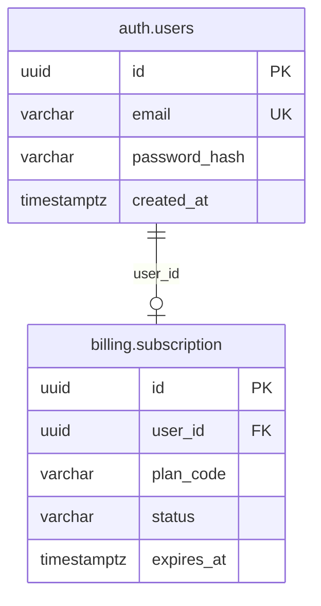

# DER-Viewer — Protocolo y Guía de Uso para Agentes de IA

> **Audiencia:** Agentes de Inteligencia Artificial (Antigravity, Claude, ChatGPT, Copilot) y Desarrolladores que automatizan la documentación de bases de datos.  
> **Objetivo:** Definir el protocolo estándar para extraer la estructura de cualquier base de datos relacional y generar diagramas ER interactivos compatibles con **DER-Viewer**.

---

## 1. ¿Qué es DER-Viewer y por qué la IA debe usarlo?

**DER-Viewer** es una plataforma interactiva estática (cero dependencias de servidor, cero bundlers) diseñada para resolver la limitación crítica de los visores de Markdown tradicionales: la incapacidad de hacer zoom profundo, navegar libremente y buscar entidades en diagramas de bases de datos medianos y grandes (15 a 100+ tablas).

Permite:
1. **Zoom focal infinito (del 5% al 3500%)** centrado en la posición exacta del cursor.
2. **Desplazamiento suave (Pan)** en un lienzo infinito acelerado por GPU.
3. **Filtros dinámicos por esquema/dominio** generados automáticamente en tiempo de ejecución.
4. **Búsqueda en tiempo real** de tablas, campos y tipos de datos con resaltado neón.
5. **Inspector de entidades** al hacer clic en cualquier tabla (muestra esquema, PK, FK, UK y columnas).
6. **Exportación vectorial SVG limpia** lista para documentación arquitectónica.

---

## 2. Protocolo de Extracción para la IA

Cuando el usuario solicite: *"Genera el DER de esta base de datos"*, la IA debe seguir este flujo de 3 pasos:

```text
[Base de Datos (Local, Bastión o Contenedor)]
                      │
                      ▼ 1. Extracción de Metadatos
        (Script PS1 / SH o SQL Nativo de Catálogo)
                      │
                      ▼ 2. Normalización de Sintaxis Mermaid
      (Aplicar patrón de Alias con corchetes y etiquetas PK/FK/UK)
                      │
                      ▼ 3. Entrega en DER-Viewer
        (Archivo .mmd en diagrams/ o preset en index.html)
```

---

### Paso 1: Extracción de Metadatos

La IA dispone de scripts listos para usar en la carpeta `scripts/`:

#### A. Si la IA tiene acceso a PowerShell (Windows):
```powershell
# Extraer esquemas específicos de PostgreSQL:
.\scripts\extract-pg-der.ps1 -HostName "localhost" -Port 5432 -User "postgres" -Database "mi_database" -Schemas @("auth", "tenants", "billing", "projects") -OutputFile "diagrams\mi_database.mmd"
```

#### B. Si la IA está en un servidor Linux / Contenedor / Bastión SSH (Bash):
```bash
chmod +x scripts/extract-pg-der.sh
./scripts/extract-pg-der.sh "127.0.0.1" 5432 "postgres" "mi_database" "diagrams/mi_database.mmd" "auth,tenants,billing,projects"
```

#### C. Si la IA debe consultar manualmente vía SQL directo:
Ejecutar la consulta universal incluida en [`scripts/extract_pg_catalog.sql`](./scripts/extract_pg_catalog.sql) contra `information_schema`.

---

### Paso 2: Reglas Críticas de Sintaxis Mermaid (OBLIGATORIO)

Para que DER-Viewer procese el diagrama sin errores de compilación, la IA **DEBE** respetar estas 4 reglas sintácticas:

#### 1. Regla de Oro: Alias con Corchetes para Nombres con Punto
❌ **INCORRECTO (Rompe el parser de Mermaid):**
```mermaid
auth.users {
    uuid id PK
}
```

✅ **CORRECTO (Patrón Alias-Etiqueta):**
```mermaid
auth_users["auth.users"] {
    uuid id PK
}
```
*El identificador interno no debe tener puntos (`auth_users`), y la etiqueta visual entre comillas y corchetes `["auth.users"]` muestra el nombre real con esquema y tabla.*

#### 2. Etiquetas de Restricciones Admitidas
Cada campo puede llevar una etiqueta al final:
* `PK`: Clave primaria.
* `FK`: Clave foránea.
* `PK_FK`: Campo que es simultáneamente clave primaria y foránea (tablas intermedias N:M).
* `UK`: Clave única / restricción de unicidad.

Ejemplo:
```mermaid
    tenants_membership["tenants.membership"] {
        uuid id PK
        uuid organization_id FK
        uuid user_id FK
        uuid role_id FK
        varchar status
        timestamptz joined_at
    }
```

#### 3. Normalización de Tipos de Datos SQL
La IA debe abreviar los tipos de datos verbosos para mantener la legibilidad visual:
* `character varying` / `varchar(255)` $\rightarrow$ `varchar`
* `timestamp with time zone` $\rightarrow$ `timestamptz`
* `timestamp without time zone` $\rightarrow$ `timestamp`
* `integer` $\rightarrow$ `int`
* `boolean` $\rightarrow$ `boolean`
* `numeric(10,2)` $\rightarrow$ `numeric`

#### 4. Notación de Relaciones
Usar la notación estándar de relación de entidad de Mermaid:
* Uno a Muchos (1:N): `padre ||--o{ hijo : "fk_col"`
* Cero o Uno a Uno (0..1:1): `padre ||--o| hijo : "fk_col"`
* Exactamente Uno a Uno (1:1): `padre ||--|| hijo : "fk_col"`

---

### Paso 3: Cómo Entregar el Resultado al Usuario

Una vez generado el código Mermaid:

1. **Guardar el archivo `.mmd`:**
   Guardarlo en `diagrams/<nombre_modelo>.mmd`.

2. **(Opcional) Registrar como Preset en la interfaz:**
   Si es un modelo principal, agregar el string al objeto `PRESETS` y una nueva `<option>` en el `<select id="model-selector">` de `index.html`.

3. **Indicar al usuario cómo abrirlo:**
   Indicar al usuario que puede abrir directamente `index.html` en su navegador o pegar el contenido en el modal **Cargar / Editar**.

---

## 3. Ejemplo Canónico Completo para la IA



Siguiendo este protocolo, cualquier IA puede documentar cualquier base de datos relacional de forma limpia y confiable para su exploración en DER-Viewer.
